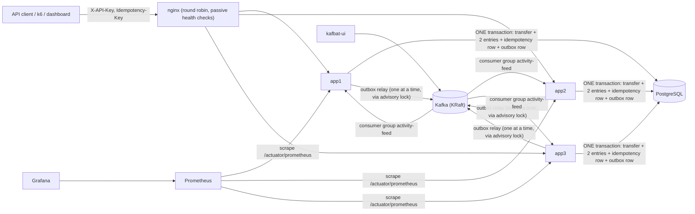

# Payments Ledger Service: Plan

> **Status: executed autonomously on 2026-10-16.** You asked me to "finish the project" overnight, so I built phases 1–7 without stopping between them. You'll review everything afterwards. Phase 8 (optional cloud VM) is **not started**: your spec says to ask you first which free option you use.
>
> Every "default I picked" below is a decision you hadn't made yet. DESIGN.md records each one as choice / alternatives / why, so any of them is easy to change.

**30-second pitch.** A small payments backend that moves synthetic money between accounts. If a request is retried, or the server crashes mid-transfer, money is never lost or duplicated, and every cent can be traced through an append-only double-entry ledger. Tests prove it:
- 100 concurrent transfers through a load balancer across 3 instances.
- One request retried 10 times.
- An instance killed mid-run.
- The app killed mid-transfer.

---

## 1. Constraints (from your spec)

- **Zero budget.** Everything runs locally with Docker Compose. No paid services and no accounts, except GitHub for the repo and CI.
- **About 8 GB for the full stack.** Every container has a memory limit with matching JVM flags (§5).
- **Synthetic data only.**

## 2. Defaults I picked for open decisions

| # | Decision | Default I picked | Why / how to change |
|---|---|---|---|
| D1 | Same key + different request | **409**, as your spec says. "Key still in progress" also returns 409, with a different problem `type`. | The IETF draft would use 422 for a mismatch. That's a one-line change in the idempotency result mapping. |
| D2 | `PENDING` state | **Kept, as a real state machine.** A transfer is inserted as `PENDING`, then moves to `COMPLETED` or `FAILED` in the same transaction. A **database trigger** rejects every other change. | The alternative is "final at insert". Inside one transaction nobody outside can see `PENDING`; DESIGN.md explains that honestly. |
| D3 | JUnit version | **JUnit 6** (managed by Boot 4.1.1). It's the same Jupiter API as JUnit 5: `@Test` and the rest. | Pinning JUnit 5 would fight Boot's dependency management. |
| D4 | Idempotency key retention | **24 h**, then a scheduled purge (configurable). | Keeps the table bounded. Stripe also keeps keys at least 24 h. |
| D5 | Who wrote the core logic | **Me**, because you asked me to finish. Branch `practice/core-logic` has the three core pieces reset to stubs, with their failing tests, so you can write them yourself. | Your original agreement was that you write them. The branch keeps that path open. |
| D6 | GitHub visibility | **Private** until you've reviewed it. Make it public with `gh repo edit --visibility public --accept-visibility-change-consequences`. | You wanted it public; private-first lets you review before anything is published. |
| D7 | Kafka message key | **From-account id** (the account money leaves). | A transfer touches two accounts. The velocity rule counts *sends* per account, so all of one sender's events stay in one partition, in order. |
| D8 | nginx retries of POST | **On:** `proxy_next_upstream error timeout non_idempotent` for `/v1/**`. **Off** for the `/v1/demo/**` buttons. | nginx never retries POSTs by default because they might not be safe to repeat. Ours are, because every `/v1` POST requires an `Idempotency-Key`. |

## 3. Stack (versions checked live 2026-10-15/16)

| Piece | Version |
|---|---|
| Java / Spring Boot | 21 / **4.1.1** (Framework 7.0.9, Hibernate 7.4.5, Jackson 3.1.5, Micrometer 1.17.1) |
| PostgreSQL | `postgres:18.6` |
| Kafka | `apache/kafka:4.3.1` (KRaft only) + Spring Kafka 4.1.1 |
| nginx | `nginx:1.30.6-alpine`, the stable branch (`nginx:alpine` is mainline) |
| kafbat-ui | `ghcr.io/kafbat/kafka-ui:v1.5.0` |
| Prometheus / Grafana | `prom/prometheus:v3.13.4` (LTS) / `grafana/grafana:13.2.4` |
| Tests | JUnit 6.0.3, Testcontainers 2.0.5, k6 `grafana/k6:2.3.0` |
| Runtime image | `eclipse-temurin:21-jre-noble` |
| Chart.js | 4.5.1, vendored into the repo (MIT licence), so the dashboard needs no CDN |

## 4. Architecture

## 5. Memory budget (WSL2 gives Docker about 7.4 GB on this laptop)

| Service | Profile | Memory limit | JVM / settings |
|---|---|---|---|
| postgres | always | 512 MB | `shared_buffers=128MB`, `max_connections=60` |
| kafka | always | 1 GB | `KAFKA_HEAP_OPTS=-Xms512m -Xmx512m` |
| app1 | lite, full | 768 MB | `-Xms384m -Xmx384m`, metaspace/code-cache/direct-memory caps |
| app2, app3 | full | 768 MB each | same |
| nginx | lite, full | 64 MB | — |
| kafbat-ui | lite, full | 512 MB | `-Xmx256m` |
| prometheus | lite, full | 384 MB | 2-day retention |
| grafana | full | 384 MB | — |
| k6 | load | 512 MB | — |
| **Total** | | **lite ≈ 3.2 GB, full ≈ 5.1 GB** (+0.5 GB during the load test) | Limits, not usage. Real usage is measured and committed under `results/`. |

**Rule:** integration tests start their own containers, so stop the compose stack before running `./mvnw verify`.

## 6. Phases (as your spec defines them)

| Phase | Builds | Proof / tests |
|---|---|---|
| 1 | Accounts, transfers, double-entry ledger on Postgres (one instance); API-key auth, validation, Problem Details, correlation id, JSON logs, invariants endpoint | `TransferIT`, `AccountApiIT`, `LedgerImmutabilityIT`, `InvariantIT` |
| 2 | Idempotency (claim first, same transaction), ordered row locks, reversals, key purge | `IdempotencyIT` (**retry ×10 → 1 transfer**), `ConcurrencyIT`, `ReversalIT` |
| 3 | Dockerfile, compose (lite/full), nginx + 3 instances, `X-Served-By` | `MultiInstanceConcurrencyIT` (**100 concurrent through nginx**), `InstanceFailoverIT` (**kill one instance mid-run**) |
| 4 | Kafka (KRaft) + kafbat-ui, publish-after-commit, activity-feed consumer with rules | `EventPublishIT`, `ActivityConsumerIT`, `PublishAfterCommitCrashIT` (proves the lost-event gap) |
| 5 | Dashboard (SSE, Chart.js), demo buttons, Prometheus + Grafana with a provisioned dashboard | `StreamIT`, `DemoIT` |
| 6 | Transactional outbox + relay, crash tests | `TransferCrashIT` (**kill mid-transfer**), `OutboxCrashIT` (replaces the phase-4 gap test) |
| 7 | GitHub Actions CI, k6 load test + committed results, README / DESIGN / RUNBOOK, demo GIF | CI green, `results/k6/` |
| 8 | *Optional* cloud VM in Terraform | **Not started.** Waits for your choice of free provider. |

Each phase ends with a git tag (`phase-1` … `phase-7`), so you can check out the code as it was at any phase.

## 7. Known limitations (starting list)

- **Out of scope (your spec):** real payment processors, multi-currency, sharding, user login.
- **No ownership model.** Any valid API key can move money between any accounts.
- **Single-node Kafka** with no replication.
- **The append-only triggers can be disabled by a database superuser,** so they are defense in depth.
- **The funding account is a hot row,** so every funding transfer queues behind it.
- **Idempotency keys expire after 24 h.**
- **Rule flags are approximate monitoring,** not blocking.
- **HTTP only** locally.
