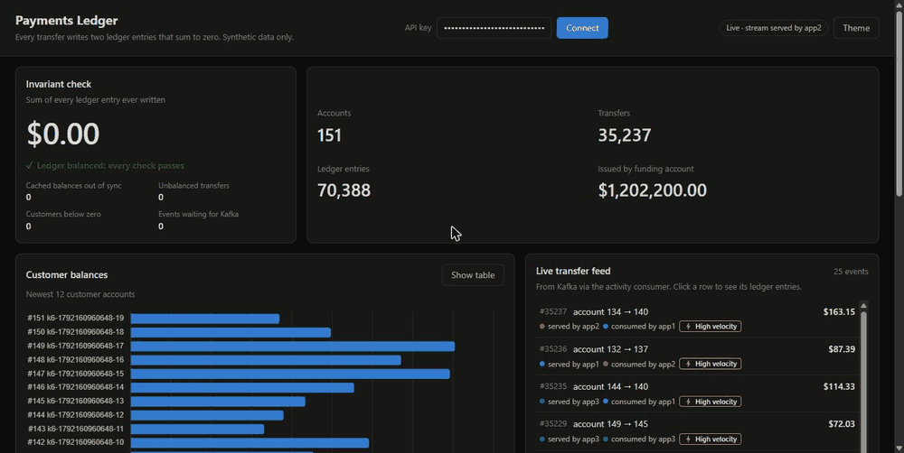
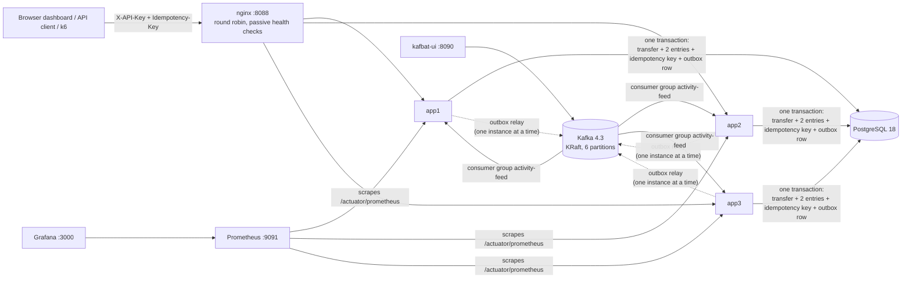
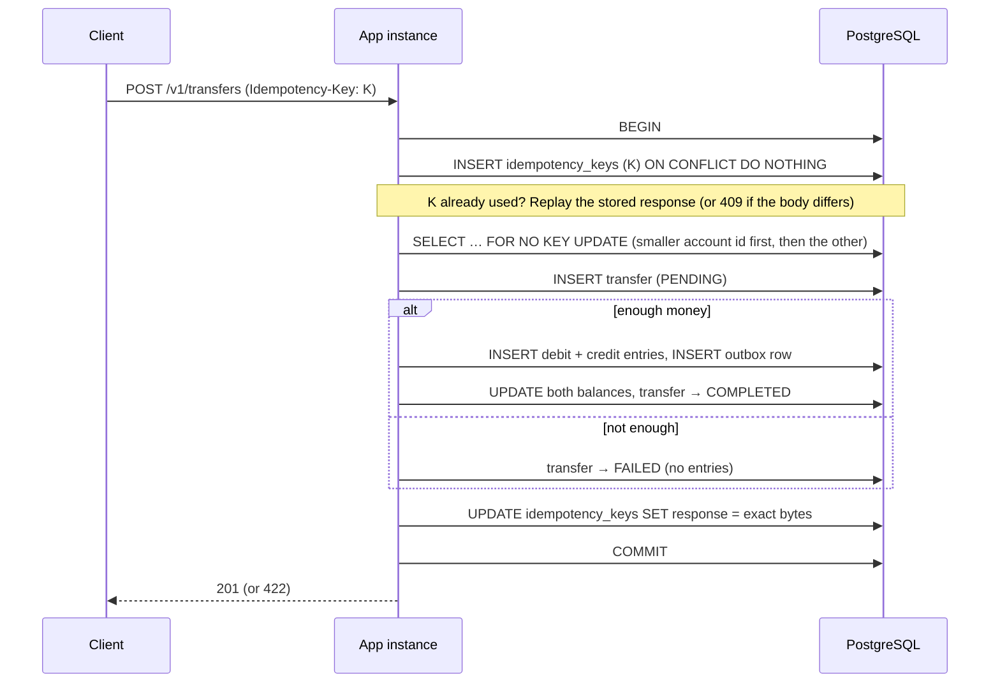
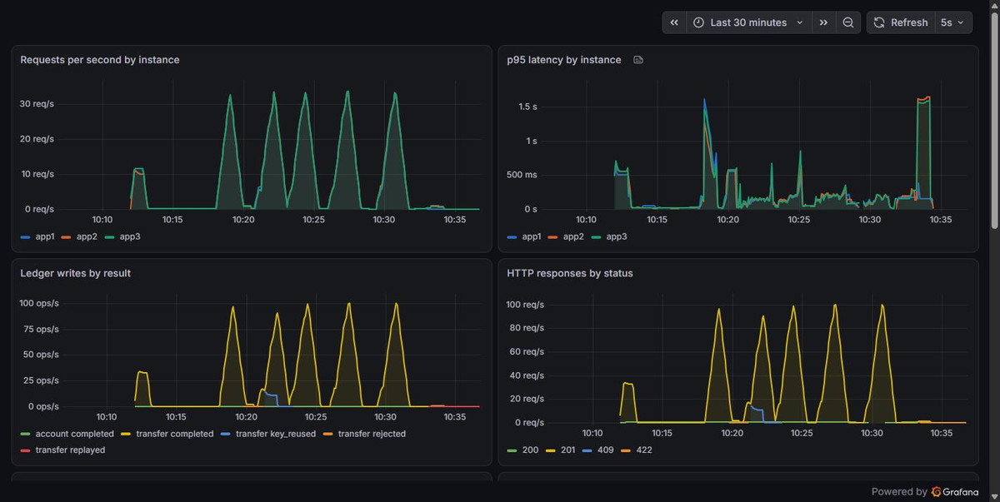

# Payments Ledger Service

A small payments backend that moves synthetic money between accounts safely.

> **If a request is retried or the server crashes mid-transfer, money is never lost or duplicated, and every cent is traceable.**

**What it is:**
- Every transfer writes two immutable ledger entries, a debit and a credit, that sum to zero.
- Every write request carries an `Idempotency-Key`, so retrying it is always safe.
- Concurrent transfers lock accounts in a fixed order, so there are no overdrafts, no lost updates and no deadlocks.
- Three instances run behind nginx and share one Postgres.
- Events reach Kafka through a transactional outbox.

**Proof:** tests kill instances in the middle of the work, and the money still adds up to the cent.

Java 21 · Spring Boot 4.1 · PostgreSQL 18 · Kafka 4.3 (KRaft) · nginx · Prometheus + Grafana · Docker Compose · Testcontainers · k6.
Everything runs locally for free. All data is synthetic.



## What it proves

| Guarantee | How | Proof |
|---|---|---|
| A retried request never moves money twice | The `Idempotency-Key` is claimed with `INSERT … ON CONFLICT DO NOTHING` in the **same transaction** as the ledger entries, and the exact response bytes are stored with it | [`IdempotencyIT.sameKeyRetried10TimesCreatesExactlyOneTransfer`](src/test/java/io/github/sanskar121543/payments/idempotency/IdempotencyIT.java) |
| Concurrent transfers are safe across instances | Both account rows are locked (`SELECT … FOR NO KEY UPDATE`) in ascending id order, and the balance is checked under the lock | [`MultiInstanceConcurrencyIT`](src/test/java/io/github/sanskar121543/payments/cluster/MultiInstanceConcurrencyIT.java): 100 concurrent transfers through nginx over 3 instances. [What breaks without locks](results/phase-2-before-locking.md) (single instance, reproducible from tag `phase-1-concurrency-evidence`) |
| Losing an instance loses and duplicates nothing | nginx re-sends interrupted POSTs to another instance, which is safe only because of the idempotency keys | [`InstanceFailoverIT`](src/test/java/io/github/sanskar121543/payments/cluster/InstanceFailoverIT.java): SIGKILL one of three instances in the middle of 600 transfers. It asserts from nginx's access log that requests were re-sent; [recorded run](results/phase-3-failover-run.md) |
| A crash mid-transfer leaves nothing half-written | Every write of a transfer is one database transaction, and Postgres commits only when it receives `COMMIT` | [`TransferCrashIT`](src/test/java/io/github/sanskar121543/payments/cluster/TransferCrashIT.java): the app is SIGKILLed after inserting the transfer, both entries and the outbox row, before committing |
| An event is never lost after a commit | Transactional outbox; a single relay with an advisory lock that keeps events in order; a consumer that retries until it succeeds and dead-letters only records that can never be processed | [`OutboxCrashIT`](src/test/java/io/github/sanskar121543/payments/cluster/OutboxCrashIT.java), [`ActivityConsumerIT`](src/test/java/io/github/sanskar121543/payments/activity/ActivityConsumerIT.java); [crash runs](results/phase-6-crash-runs.md) |
| The ledger is append-only | Database triggers reject `UPDATE`/`DELETE`/`TRUNCATE` on entries. Transfers may only move `PENDING → COMPLETED/FAILED` | [`LedgerImmutabilityIT`](src/test/java/io/github/sanskar121543/payments/ledger/LedgerImmutabilityIT.java) |
| Every cent is traceable | Signed entries per account, and an invariant check: all entries sum to 0, and cached balances equal the ledger | `GET /v1/ledger/invariants`, [`InvariantIT`](src/test/java/io/github/sanskar121543/payments/ledger/InvariantIT.java) |

## Architecture (what runs where)

Everything below runs on one machine with `docker compose --profile full`.



### One transfer, step by step



## Run it

You need Docker Desktop (or Docker Engine) with about 8 GB of memory available.

```bash
cp .env.example .env                                # local-only demo credentials (or generate your own: scripts/new-api-key.sh)
docker compose --profile full up -d --build --wait  # postgres, kafka, 3 app instances, nginx, kafbat, prometheus, grafana
scripts/smoke.sh                                    # end-to-end check through nginx
```

| Open | What |
|---|---|
| http://localhost:8088 | Dashboard. Paste `DEMO_API_KEY` from `.env` |
| http://localhost:3000 | Grafana (anonymous read-only) |
| http://localhost:9091 | Prometheus |
| http://localhost:8090 | kafbat-ui (Kafka topics and consumer groups) |

**Profiles:**
- `--profile lite`: one app instance, no Grafana (daily work).
- No profile: only Postgres and Kafka, so you can run the app from your IDE with `./mvnw spring-boot:run`.

Every port is bound to `127.0.0.1` only: the demo key in `.env.example` is public, so the API must not be reachable from your network. Ports and memory limits are in `compose.yaml` and `.env.example`. [RUNBOOK.md](RUNBOOK.md) covers day-to-day operation, killing an instance on purpose, and troubleshooting.

### API

Every endpoint except the dashboard's static files and `/actuator/health` requires `X-API-Key` (deny by default). Every `POST` also requires `Idempotency-Key`.

| Method | Path | |
|---|---|---|
| `POST` | `/v1/accounts` `{"name"}` | Create a customer account (balance 0) |
| `GET` | `/v1/accounts`, `/v1/accounts/{id}`, `/v1/accounts/{id}/entries` | Balances and the entries behind them |
| `POST` | `/v1/transfers` `{"fromAccount","toAccount","amountCents"}` | `201` completed · `422` insufficient funds (stored as `FAILED`) · `409` same key with a different body |
| `GET` | `/v1/transfers/{id}`, `/v1/transfers?limit=` | A transfer with its two ledger entries |
| `POST` | `/v1/transfers/{id}/reversals` | Full reversal as a new transfer with opposite entries; at most once |
| `GET` | `/v1/ledger/invariants` | Sum of all entries, cached-balance mismatches, unbalanced transfers |
| `GET` | `/v1/activity`, `/v1/stream` | Kafka-built activity feed with rule flags; live SSE stream |

```bash
source .env
curl -s -X POST localhost:8088/v1/transfers -H "X-API-Key: $DEMO_API_KEY" -H "Idempotency-Key: demo-1" \
     -H 'Content-Type: application/json' -d '{"fromAccount":1,"toAccount":2,"amountCents":2500}'
```

Errors are [RFC 9457](https://www.rfc-editor.org/rfc/rfc9457) problem details with a stable `type`, for example `/problems/insufficient-funds`.

## Load test

**One command:** `scripts/load-test.sh 100 60s`.
- It starts the full stack and runs [k6](load/transfers.js) inside Docker (nothing to install), through nginx against all three instances.
- It writes [`results/k6/`](results/k6) with the hardware, the Docker host and the git commit.
- The run **fails** if any status other than 201/422 appears, if the ledger invariant breaks, or if money is not conserved.

The table below is copied verbatim from [`results/k6/latest.md`](results/k6/latest.md). A unit test ([`ReadmeResultsSyncTest`](src/test/java/io/github/sanskar121543/payments/ReadmeResultsSyncTest.java)) fails the build if they ever differ.

<!-- k6-results:start -->
| Metric | Value |
|---|---|
| Scenario | 100 transfers/s offered for 60s (after a 20 s warm-up that is not counted), constant arrival rate, through nginx to 3 instances |
| Transfer requests sent | 6001 |
| Completed (201) / refused for insufficient funds (422) | 6001 / 0 |
| Unexpected status codes (warm-up included) | 0 |
| Dropped iterations (not sent: every virtual user was still waiting on a slow response; not in the latency figures) | 0 |
| Latency p50 / p90 / p95 / p99 | 9.7 ms / 50.5 ms / 165.2 ms / 427.5 ms |
| Latency max | 874.5 ms |
| Ledger invariant after the run | holds (all entries sum to 0) |
| Money conserved across the 20 accounts | yes |
| Hardware | ASUS ROG Strix G713PV laptop, AMD Ryzen 9 7845HX (12 cores / 24 threads), 15.2 GB RAM, Windows 11 Home, Docker Desktop with WSL2 |
| Docker host | 24 CPUs, 7905939456 bytes RAM visible to Docker, Docker Desktop, engine 29.8.0 |
| Other load on the machine | 24 containers of an unrelated OpenTelemetry demo, including its own load generator, were running at the same time |
| Recorded | 2026-10-16T19:42:22.831Z, commit 1e70946 |
<!-- k6-results:end -->

This run shared the laptop with another busy Docker workload, as the table says, and that makes the tail noisy: runs of the same commit minutes apart differed several-fold at p95 and p99. Every recorded run, including those, is listed in [`results/k6/history.md`](results/k6/history.md). Re-run the script on your own machine for your own numbers.

## Observability

- **Metrics:** each instance exposes `/actuator/prometheus` with an `app_instance` tag. Prometheus scrapes them on the internal network; from outside, nginx answers 404 for everything under `/actuator` except `/actuator/health`, and 400 for any path containing `;`.
- **Grafana dashboard:** the provisioned dashboard shows per-instance request rate and p95, ledger writes by result, lock timeouts, DB connections, JVM heap, Kafka consumer lag, rule hits and the outbox backlog.
- **Logs:** ECS JSON, with the correlation id (from `X-Correlation-Id` or nginx's request id) and the instance id on every line.



## Tests

```bash
docker compose --profile full down   # integration tests start their own containers; don't run both at once
./mvnw verify                        # unit tests + Testcontainers integration tests (Docker required)
```

**Unit tests** cover pure logic: lock order, request fingerprint, API keys, the outbox relay with a mocked Kafka.

**Integration tests (`*IT`)** come in two kinds:
- **In-process:** they start the app in-process against Postgres and Kafka containers.
- **Cluster tests:** in `cluster/`, they start the packaged jar in several containers behind nginx, using the same `nginx.conf` as compose, so they can SIGKILL real processes.

CI ([`.github/workflows/ci.yml`](.github/workflows/ci.yml)) runs all of the above, then boots the full compose stack and runs `scripts/smoke.sh`.

## Project layout

Package by feature under `src/main/java/io/github/sanskar121543/payments`:

| Package | Contents |
|---|---|
| `account` | Accounts API, entity with the debit/credit guard |
| `transfer` | `TransferService` (locking, balance check, reversals), queries, controller |
| `ledger` | Immutable entries, invariant check |
| `idempotency` | Claim-first idempotency, request fingerprint, key purge |
| `outbox` | Outbox writer and relay |
| `events`, `activity` | Event schema and topic; Kafka consumer, rules and activity feed |
| `dashboard`, `demo` | SSE live feed; the dashboard's server-side demo runs |
| `web`, `common` | API-key and correlation-id filters, problem details; instance id, metrics, singleton-job lock |

Static dashboard: `src/main/resources/static`. Migrations: `src/main/resources/db/migration`.

## Known limitations

- **Out of scope:** real payment processors, multi-currency, sharding, user login.
- **No ownership model.** Any valid API key can move money between any accounts.
- **Single-node Kafka with no replication.** Everything runs on one machine; this is not a production deployment.
- **The funding account is a hot row.** Every funding transfer queues on its lock.
- **Idempotency keys expire after 24 h.** A retry after that is treated as a new request.
- **Rule flags (large amount, velocity) are approximate monitoring.** They do not block transfers.
- **The live feed re-checks the last 500 feed rows every second** to catch rows that commit out of id order. A row that commits even later can be missing from the live view; it is still in `GET /v1/activity`.
- **Events that can never be processed** (for example unreadable JSON) go to the dead-letter topic `transfer.completed.DLT`. Nothing replays them automatically; inspect them in kafbat-ui.
- **Defense in depth, not tamper-proofing.** The append-only triggers can be disabled by a database superuser, and the app connects as the database owner.
- **HTTP only.** There is no TLS locally.

[DESIGN.md](DESIGN.md) records every decision (choice / alternatives / why). [RUNBOOK.md](RUNBOOK.md) covers operation. [PLAN.md](PLAN.md) is the plan the work followed.
