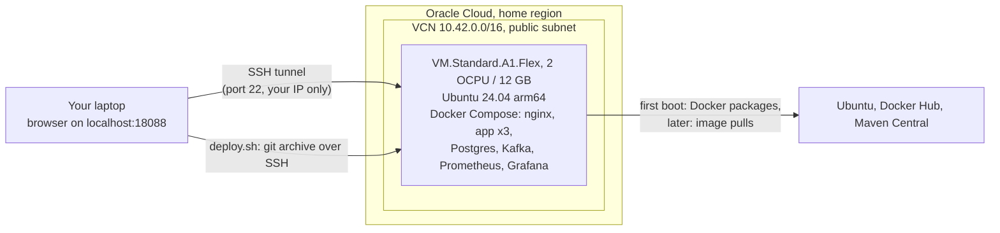

# Phase 8: one Always Free VM on Oracle Cloud

The same `compose.yaml` stack that runs on a laptop, on one Ampere (Arm) VM from Oracle's Always Free tier.
Nothing is publicly reachable except SSH from one IP address. The dashboard, Grafana and the API stay on the VM's
loopback interface, exactly as locally, and you reach them through an SSH tunnel.



The VM never talks to GitHub: `deploy.sh` sends a commit from your machine over SSH, so the repo can stay private.

## What Terraform creates, and why it stays free

Oracle's Always Free tier covers 1,500 OCPU hours and 9,000 GB hours of Ampere A1 a month, which it equates to
**2 OCPUs and 12 GB** in total (it was 4 OCPUs and 24 GB until 2026), plus 200 GB of block storage.

| Resource | Why | Always Free allowance it uses |
|---|---|---|
| VCN, internet gateway, route table, subnet | A network for the VM with a route out (for packages and image pulls) | Free, no allowance |
| Security list | Allows SSH from `ssh_allowed_cidr` only. The VCN's default list is taken over with no rules | Free, no allowance |
| `VM.Standard.A1.Flex`, 2 OCPU / 12 GB | Runs the full profile: about 5.2 GB of container limits, about 3 GB used under load | All of the A1 allowance |
| 100 GB boot volume | OS, images, Postgres and Kafka data. Block volume speed grows with size, so 100 GB has twice the IOPS of 50 GB | Half of the 200 GB, which leaves room for Oracle's two free AMD micro VMs |
| Ephemeral public IP | So you can SSH in | Free |

Not used, on purpose: load balancers, NAT gateways, reserved IPs, managed databases or any other billed service.
The variables refuse more than 2 OCPUs, 12 GB of memory or a 200 GB boot volume.

## Before you start

- An Oracle Cloud account, with an API key in `~/.oci/config` (`oci iam region list --profile DEFAULT` works).
- Terraform 1.6 or newer, and an SSH key pair **without a passphrase** (the deploy can run unattended). The defaults
  expect `~/.ssh/payments-ledger-oci` and `.pub`: `ssh-keygen -t ed25519 -N '' -f ~/.ssh/payments-ledger-oci`.
- `cp terraform.tfvars.example terraform.tfvars`, then set `tenancy_ocid` (the `tenancy=` line of `~/.oci/config`) and
  `ssh_allowed_cidr` (your IP from `curl https://checkip.amazonaws.com`, plus `/32`). The file is gitignored.

## Deploy

Always Free Arm capacity is often sold out, so the usual way is to let a script wait for it:

```bash
cd infra/oci
./wait-and-apply.sh    # checks every 2 minutes; when a domain has room: plan, apply, then deploy.sh
```

Each round it asks for 2 OCPU / 12 GB, then for 1 OCPU / 6 GB (`FALLBACK_SHAPE`), and tries every domain that
reports room. Every 10th round it tries a real launch even if the report says no, because the report can lag. A
failed attempt creates only the network, which is free. Capacity, rate limits and network errors mean "wait again";
it stops only on errors that waiting cannot fix. It is built to be left running for days:

- only one copy runs at a time (`.wait-and-apply.lock`), and editing the script while it runs does not affect it;
- it stops as soon as the VM is in the Terraform state, and never applies a plan that deletes or replaces anything;
- it will not launch while any other A1 instance exists in the compartment, since two could go past the free amount;
- once the VM exists, it writes its domain and shape into `terraform.tfvars`, so later applies keep it as created;
- before each attempt it refreshes `ssh_allowed_cidr`, in case your IP changed while it waited.

Stop it from Git Bash with `kill "$(cat .wait-and-apply.lock/pid)"`. It finishes a running terraform command first.

By hand, if `./capacity-check.sh` already shows a domain as `AVAILABLE`:

```bash
terraform init
terraform plan -out=phase8.tfplan   # with availability_domain_number set to that domain
terraform apply phase8.tfplan       # creates the 7 resources
./deploy.sh                         # waits for Docker on the VM, sends HEAD, builds, starts, runs the smoke test
```

The first `deploy.sh` makes the VM's secrets (Postgres and Grafana passwords, the demo API key) on the VM, so they
never appear in Terraform state, user data or the repo. Then:

```bash
eval "$(terraform output -raw demo_api_key)"     # the API key generated on the VM
eval "$(terraform output -raw tunnel)"           # leave running, then open http://localhost:18088 and http://localhost:13000
```

## On the VM

`eval "$(terraform output -raw ssh)"`, then `cd /opt/payments-ledger-service`. The RUNBOOK's checks and demos work
there (`docker compose ps`, `scripts/smoke.sh`, killing an instance, `scripts/load-test.sh 100 60s`), with two
differences:

- **`.env` belongs to `deploy.sh`.** Never recreate it from `.env.example`: the Postgres data is tied to the password
  in it, and `.env.example` has the public demo key (`vm-deploy.sh` refuses to start with that key). To rotate the
  API key, edit its two lines as in the RUNBOOK's "Rotate the API key".
- **Tests run on the laptop or in CI,** not on the VM: it has no JDK and does not need one.

Load-test results on the VM stay in the VM's own `results/k6` (a redeploy leaves them alone) and record the VM's
hardware at run time and the commit `deploy.sh` sent. To bring them home, without touching the laptop's results:

```bash
mkdir -p ../../results/k6-oci
scp -i ~/.ssh/payments-ledger-oci "ubuntu@$(terraform output -raw public_ip):/opt/payments-ledger-service/results/k6/*" ../../results/k6-oci/
```

## Update the VM

Commit, then `./deploy.sh` (or `./deploy.sh <tag-or-sha>` for any commit that includes this directory). Uncommitted
changes are not sent. The data, `.env` and the VM's results stay; the stack restarts on the new images. To switch
between `full` and `lite`, change `compose_profile` in `terraform.tfvars`, `terraform apply` (no resource changes)
and `./deploy.sh`.

If the waiter took the 1 OCPU / 6 GB fallback, grow the VM later to the free maximum: set `ocpus = 2` and
`memory_in_gbs = 12` in `terraform.tfvars` and `terraform apply`. The VM is resized in place (it reboots, and the
stack restarts with it) when its host has room; if not, the apply fails and nothing changes.

The SSH key is ignored after the VM is created (a new key would otherwise replace the VM and its data). To rotate
it, add the new public key to `~/.ssh/authorized_keys` on the VM, then remove the old one.

## When Oracle stops the VM

Oracle may stop an Always Free VM it considers idle: over 7 days, CPU (95th percentile), network and memory all
below 20%. An idle demo VM can qualify. It is stopped, not deleted, and the data stays. Start it in the console or
with `oci compute instance action --action START --instance-id <id>`: a systemd unit starts the stack at boot, as it
does after any reboot.

## Your IP changed

SSH stops connecting. Update `ssh_allowed_cidr` in `terraform.tfvars` and `terraform apply`: only the security list changes.

## Remove everything

```bash
ssh-keygen -R "$(terraform output -raw public_ip)"   # forget the host key: a new VM may get the same IP
terraform destroy                                    # deletes the VM, its boot volume and the network
```
